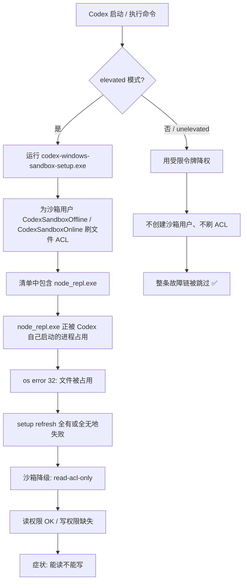

# Codex for Windows 沙箱故障：「能读不能写」的完整排查与修复

> 适用场景：Codex 桌面版（Windows）在默认的 `[windows] sandbox = "elevated"` 模式下，
> 突然出现**文件能读、写不进去**，并且 `~/.codex/.sandbox/*.log` 里反复报
> `runtime read/execute validation failed ... os error 32`。
>
> 本文是一次真实故障的完整复盘：从现象、定位、根因到修复与验证，附可直接运行的诊断脚本。

---

## TL;DR

| 项目 | 结论 |
|---|---|
| **症状** | Codex 能读文件但写不进去；沙箱日志持续刷 `setup refresh completed with errors` |
| **根因** | `elevated` 模式下，沙箱初始化程序要给**正在运行的** `node_repl.exe` 补 ACL，结果自己把自己锁住 → `os error 32`（另一个程序正在使用此文件）→ `setup refresh` 全有或全无地失败 → 沙箱降级为「只读授权」 |
| **修复** | `~/.codex/config.toml` 中 `[windows]` 段的 `sandbox` 由 `"elevated"` 改为 **`"unelevated"`**，然后**完整重启** Codex |
| **顺带必改** | `model_catalog_json` 必须写**绝对路径**，否则 Codex 会直接启动失败 |
| **重要提醒** | 这是**换一条不经过 bug 的路**，不是官方修复。等 Codex 修掉这个竞态后，建议改回 `elevated` |

**核心原理一句话**：`elevated` 靠「额外创建两个沙箱用户 + 给文件刷 ACL」实现隔离，每轮都要碰运行时文件；
`unelevated` 改用**受限令牌**降权，**完全不碰 ACL**，于是整条故障链被跳过。

---

## 一、环境

| 项 | 值 |
|---|---|
| 系统 | Windows 11（x64） |
| 客户端 | Codex 桌面版 |
| Codex 版本 | `0.162.0-alpha.2`（故障发生版本） |
| 相关目录 | `%USERPROFILE%\.codex\` |
| 沙箱日志 | `%USERPROFILE%\.codex\.sandbox\sandbox.YYYY-MM-DD.log` |

> 不同版本的目录/字段名可能略有差异，但定位思路一致。

---

## 二、症状

1. **最直观的表现**：让 Codex 新建/修改文件，命令看似执行了，文件却没有落盘。
2. 让 Codex「把日志导出到桌面」，导出文件是 **0 字节**。
3. Codex 新建的会话工作目录（默认在 `~/Documents/Codex/<日期>/<项目名>/`）**全是空的**——重复试了很多次，一次都没写进去。
4. 界面上可能出现沙箱相关报错；沙箱日志里的关键行：

```
runtime read/execute validation failed: validate runtime read/execute access on
...\OpenAI\Codex\runtimes\cua_node\<hash>\bin\node_repl.exe:
open ACL target for root-only update: 另一个程序正在使用此文件，进程无法访问。(os error 32)
→ setup refresh completed with errors
→ top-level error
```

**关键定性**：读文件正常、写文件失败。这说明沙箱并没有完全失效，而是**只完成了「读」的授权**。

---

## 三、定位过程

### 3.1 先做排除法

| 排查项 | 方法 | 结果 |
|---|---|---|
| 磁盘是否满 | `df -h` / `Get-PSDrive` | 正常（剩余几十 GB）→ 排除 |
| 文件系统/杀软是否全局拦截 | 在目标目录用 shell 写入测试文件并读回 | 成功 → 排除 |
| 是否某个进程长期死锁占用文件 | ctypes `CreateFileW` 尝试「写数据/删除/写 ACL/改属主」各种组合 | **全部成功** → 说明占用是**瞬时**的，不是长期锁 |

> 第 3 条很关键、也很反直觉：**手动测试测不到的占用，恰恰是根因的形态**——
> 那个占用只存在于沙箱 setup 自己的探测进程运行的那几毫秒里，只有它自己撞得上。

### 3.2 再看沙箱日志

日志在 `%USERPROFILE%\.codex\.sandbox\`：

```bash
# 统计「setup 成功（errors=[]）」与「失败」的次数
grep -c "errors=\[\]" sandbox.2026-10-08.log
grep -c "setup refresh completed with errors" sandbox.2026-10-08.log

# 定位报错对象
grep "runtime read/execute validation failed" sandbox.2026-10-08.log | tail -3

# 关键降级标志：只刷了读 ACL
grep -i "read-acl-only" sandbox.2026-10-08.log
```

本次故障的日志特征：

- 某个时间点之前 `errors=[]`（正常）；之后 **0 次成功**，错误累计 **200+ 次**。
- 报错对象始终是同一个文件：运行时目录下的 `node_repl.exe`。
- 出现 `read-acl-only mode: applying read ACLs` —— **只申请了读权限，写权限没补上**，与用户观察到的「能读不能写」完全吻合。
- `%USERPROFILE%\.codex\.sandbox\setup_error.json` 里记录 `helper_unknown_error`。

---

## 四、根因

### 4.1 因果链



### 4.2 为什么会「自己锁自己」

Windows 没有 Linux 那种 namespace 沙箱。Codex 的 `elevated` 沙箱走的是很「土」但有效的办法：

> **额外创建两个本地用户账号（`CodexSandboxOffline` / `CodexSandboxOnline`），让命令以它们的身份运行。**

为此，它每次执行前都要用 `codex-windows-sandbox-setup.exe` 给一批文件**重刷 ACL**（让沙箱用户能访问）。

而 `node_repl.exe` 是 Codex 自己会启动的 MCP 服务进程——**一个正在运行的 exe，无法被以「重写 ACL」的方式打开**，于是触发共享冲突 `os error 32`。

`setup` 又是**全有或全无**的：清单里任何一个目标刷不上，整轮就返回失败。失败的沙箱退化成 `read-acl-only` 半初始化状态：**读补上了，写没有**。

### 4.3 触发时机

日志显示它不是一直坏，而是**在某个时刻之后才开始坏**。本次的触发点是工作区（write roots）集合发生变化（切换/新建 Codex 会话），导致 setup 需要重新给运行时补 ACL，从而撞上那个瞬时占用。

> 也就是说：这是个**竞态 bug**——只要「重刷 ACL」和「node_repl 正在运行」同时发生，就会踩中。
> 所以「重启一下」有时能好一阵，但**重开新会话/切工作区就可能再次复发**。这也是它比一次性故障更难缠的原因。

---

## 五、修复

### 5.1 备份配置

```bash
cp -p "%USERPROFILE%\.codex\config.toml" "%USERPROFILE%\.codex\config.toml.bak"
```

### 5.2 修改 `%USERPROFILE%\.codex\config.toml`

```diff
  # 第 5 行附近：必须是绝对路径（相对路径会导致 Codex 启动即报错）
- model_catalog_json = "cc-switch-model-catalog.json"
+ model_catalog_json = 'C:\Users\<你的用户名>\.codex\cc-switch-model-catalog.json'

  # [windows] 段：把沙箱模式从 elevated 换成 unelevated
  [windows]
- sandbox = "elevated"
+ sandbox = "unelevated"
```

### 5.3 完整重启 Codex

`[windows] sandbox` 是**启动时读取**的，必须重启才生效。
注意要**退干净**——任务栏托盘图标也要退出，确认进程真的没了：

```powershell
Get-Process | Where-Object { $_.ProcessName -match 'codex|node_repl' }
```

### 5.4 验证

重启后，让 Codex 在某个目录新建一个文件（例如写入 `hello`），然后：

```bash
# 1) 最新日志里 setup 是否还在报错
tail -20 "%USERPROFILE%\.codex\.sandbox\sandbox.$(date +%F).log"

# 2) 关键指标：修复后 setup refresh 是否彻底不再运行
grep -c "setup refresh: spawning" "%USERPROFILE%\.codex\.sandbox\sandbox.$(date +%F).log"

# 3) 文件是否真的落盘
ls -la <你让 Codex 写入的文件>
```

本机修复后的实测对比（可直接作为「成功判据」参考）：

| 指标 | 修复前 | 修复后 |
|---|---|---|
| `setup refresh` 执行次数 | 每条命令都跑 | **0 次** |
| ACL 报错（os error 32） | 累计 200+ 次 | **0 次** |
| 日志中命令执行结果 | 只有 `START`，无结果 | **多次 `SUCCESS`** |
| 实际落盘 | 会话目录全空 | 测试文件**真实生成** |

> 注意判据是「**setup 不再运行**」，而不是「界面不报错了」。

---

## 六、原理：`elevated` vs `unelevated`

| | `elevated`（默认） | `unelevated`（修复后） |
|---|---|---|
| 隔离方式 | 创建 2 个沙箱本地用户 + 刷文件 ACL | 用**受限令牌**降权运行 |
| 是否需要沙箱用户 | 需要（`CodexSandboxOffline`/`Online`） | **不需要** |
| 是否每轮刷 ACL | **是**（故障来源） | **否**，整条环节被跳过 |
| 隔离强度 | 更强 | 较弱（少了独立用户账号那层） |
| 本故障下 | ❌ 触发 `os error 32` | ✅ 正常工作 |

**一句话**：`unelevated` 不是把 bug 修好了，而是**换了一条不经过 bug 的路**。
Codex「自己锁自己」的缺陷仍在，只是不再被触发。等官方修复后，可以改回 `elevated` 拿回完整隔离。

---

## 七、踩坑记录（这些「建议」都是错的）

### ❌ 坑 1：`sandbox = "none"`

网上（包括某些 AI 助手）会建议把 `[windows] sandbox` 改成 `"none"` 来关沙箱。
**`none` 根本不是一个合法值**，`[windows]` 段只接受 `elevated` / `unelevated`。
填了它，Codex 会直接弹出「无法加载配置」而**启动失败**。

> 教训：改配置前，先去程序里核对合法取值，别凭印象编。
> 可用 `grep -a` 在 `codex.exe` 里搜字段名附近的枚举字符串来确认。

### ❌ 坑 2：`model_catalog_json` 用了相对路径

```toml
model_catalog_json = "cc-switch-model-catalog.json"   # ❌ 相对路径
```

该字段类型是 `AbsolutePathBuf`，要求绝对路径，否则 Codex 启动时报：

```
config.toml:69:11  AbsolutePathBuf deserialized without a base path in "model_catalog_json"
```

改成绝对路径即可。**注意**：这个报错有时会**信息错位**——行列指向的是另一处非法值，却贴了这条消息，
排查时别被它带偏，两处都要检查。

### ❌ 坑 3：`sandbox_mode = "danger-full-access"` 能解决读写问题

**不能。** `sandbox_mode` 管的是**权限策略**（读写范围），而 `[windows] sandbox` 管的是**要不要挂 Windows 沙箱外壳**。

实测：在 `danger-full-access` 下，`setup refresh` 仍照跑、仍失败。它既不解决 bug，还让 Codex 的**命令不再受目录限制**，纯属降低安全性。
**不要用它来「绕过」本问题。**

- `sandbox_mode` 合法值：`read-only` / `workspace-write` / `danger-full-access`
- `[windows] sandbox` 合法值：`elevated` / `unelevated`

---

## 八、FAQ

<details>
<summary><b>Q：为什么我手动测文件占用，测不出「被占用」？</b></summary>

因为那个占用是**毫秒级**的，只发生在 setup 自己启动探测进程的那一瞬间。用任何外部工具测都是「能打开」。
根因是竞态，不是长期死锁——这也解释了为什么「重启」有时有效、有时无效。
</details>

<details>
<summary><b>Q：重启一次就好了，是不是不用改配置？</b></summary>

这是赌运气。只要再次触发「重刷 ACL × node_repl 正在运行」，就会复发。
本次故障就是从某个时间点起**持续失败、0 次成功**，重启并没有恢复。建议直接改 `unelevated`。
</details>

<details>
<summary><b>Q：改成 `unelevated` 安全吗？</b></summary>

比 `elevated` 弱，比「关沙箱」强得多。它是用一个降权令牌运行命令，仍然有隔离。
在官方修掉竞态之前，这是**功能与安全之间最合理的折中**。
</details>

<details>
<summary><b>Q：如果 `unelevated` 也不行怎么办？</b></summary>

下一步是注释掉 `config.toml` 里的 `[mcp_servers.node_repl]` 整段——报错对象就是这个 exe，不启动它自然不会再被占用。
代价是失去 Node REPL 这个 MCP 功能（可能影响浏览器控制类能力）。
</details>

<details>
<summary><b>Q：`node.exe` 和 `node_repl.exe` 是不是同一个文件（硬链接）互锁？</b></summary>

不是。实测两者体积不同（约 93 MB / 34 MB）、`fsutil hardlink list` 各自只有一条链接，是**两个独立文件**。
</details>

---

## 九、诊断脚本

`scripts/check-sandbox.ps1` 一键输出：沙箱日志的错误统计、最近报错、当前配置取值、进程状态、磁盘余量。
在排查前和修复后各跑一次，对比即可。

```powershell
powershell -ExecutionPolicy Bypass -File .\scripts\check-sandbox.ps1
```

---

## 十、免责与状态

- 本文记录的是**对实际故障的现象复现与规避**，`unelevated` 属于**绕过**，不是官方修复。
- 根因在 Codex 自身的沙箱初始化逻辑（setup 与运行时文件之间的竞态），**最终修复需等待官方更新**。
- 版本、路径、字段名可能随 Codex 迭代变化，请以你本机实际为准。
- 修改配置前请**务必备份** `config.toml`。

---

## License

MIT —— 欢迎自由引用、转载、提 Issue 补充你的环境与结果。
